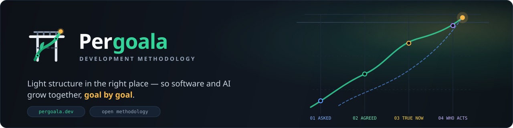

  <picture>
    <source media="(prefers-color-scheme: dark)" srcset="https://raw.githubusercontent.com/pergoala/.github/main/assets/banner-dark.svg">
    <source media="(prefers-color-scheme: light)" srcset="https://raw.githubusercontent.com/pergoala/.github/main/assets/banner-light.svg">
    
  </picture>

   

  

    
    
    
    
  

---

## Light structure in the right place

**Pergoala** (*pergola* + *goal*) is an open methodology, currently in the making, for teams that build software together with AI.

A pergola is a light supporting frame: a few posts and beams that give a fast-growing vine hold in the wind, shelter overhead, and direction upward. It is neither a wall nor a cage — you can see through it, sit under it, and retie a branch when it sets off another way. Across a larger organisation, one shared frame spans domains, standards, and repositories to hold them together.

**Strict where change is expensive. Loose where it is cheap.**

### The two scarcities

> **People have the background knowledge, but little attention.**  
> **The AI has time, but no background knowledge.**

Pergoala builds the two paths between them:

- **People → AI:** short, ordered, machine-checked background knowledge (`spine-0`), so the AI works from real product truth instead of guessing.
- **AI → People:** small batches, diagrams, and tables a human can review quickly — carried by an agent that acts as an active adviser and creative idea partner next to every role.

### Four questions kept clear at AI speed

Roles and workflows differ by company. Four questions stay constant:

| Pillar | Question | Focus |
| :--- | :--- | :--- |
| **01** | **What was asked** | Separate gap-finding before code; examples and tables both humans and machines can verify |
| **02** | **What was agreed** | Durable backbone only where change is expensive; conceptual model, boundaries, and verified bindings |
| **03** | **What is true now** | Built, accepted, and shipped stay distinct; every claim has a guardian or is regenerated by machine |
| **04** | **Who acts next** | One owner per waiting item; clean role handovers across humans and agents |

### Who it is for

- **A human team where every role works with AI** — product, architecture, build, and verification stay distinct, with AI advising each role.
- **An AI-native company** — one human directing a practiced team of role-based agents, where human attention is the tightest bottleneck.
- **An organisation still building its floor** — bringing sensible defaults and teaching good working habits during everyday use.

### Status

The methodology, its research foundation, and the `spine-0` tooling are currently being developed and tested in private working repositories and will be published openly once proven through real iterations.

- Website: [pergoala.dev](https://pergoala.dev) *(reserved)*
